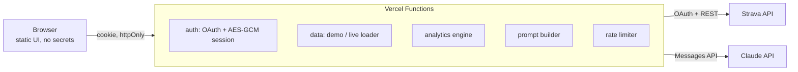

# Trail.AI

Endurance training analytics on Strava data, with an LLM coach that only reasons over metrics computed server-side.

**Live demo:** https://trail-dashboard-one.vercel.app/?mode=demo (fictional athlete, 16 weeks of synthetic data) · **[How it's built](https://trail-dashboard-one.vercel.app/how-its-built.html)**


## What it does

A Today verdict (train, easy day or rest) in one sentence, five plain metrics behind it, a race readiness gauge, and a coach you can talk to. You write *"good run this morning, heavy legs at the start"*; the coach identifies which Strava activity you mean, pulls its second-by-second streams, and crosses your feeling with the numbers.

| Metric | Definition | Why it matters |
|---|---|---|
| **Load vs usual** | Heart-rate load of the last 7 days against the average 7-day load of the 4 weeks before | Spikes are what get runners hurt. Roughly -10% to +15% is the range to build in. |
| **Easy share** | % of running time in heart-rate zones 1-2, from sessions with HR data | About 80% easy keeps hard days hard. |
| **Climbing speed** | Vertical metres per hour on sustained climbs (50 m or more of gain at 3% grade or steeper), 3-week average | The trail-specific fitness number. |
| **Aerobic engine** | Pace at your easy heart rate, from flat easy runs of 20 minutes or more | If this gets faster at the same heart rate, the aerobic base is improving. |
| **Cardiac drift** (per session) | Heart rate rise in the second half of a steady flat run vs the first, after warm-up | Under 5% means durable endurance at that duration. |

**Race readiness** checks two rules of thumb over the last 12 weeks against a target race: longest run (vs 2/3 of the race distance up to 60 km; for ultras the rule switches to time on feet, about 5.5 h) and biggest week of climbing vs the race D+. There is no average: the score is the weaker of the two, and the card leads with the limiting factor. Climbing speed is shown as context only, because training speed on short fresh climbs is not comparable to race-average climbing speed. The demo uses a fictional 50 km / 2,500 m race; live mode reads the owner's race from the `RACE_TARGET` setting.

Internally the model uses heart-rate load (a Banister-style impulse), acute vs chronic load and efficiency factor; the interface and the coach only use the plain terms above.

## Architecture



```
public/            static frontend (vanilla JS + Chart.js)
  js/analytics.js  pure metric functions, shared by browser and server
  js/demo-data.js  deterministic synthetic athlete (seeded PRNG, Strava-shaped)
  js/app.js        UI
api/               serverless endpoints
  auth/login       → Strava consent, CSRF state cookie
  auth/callback    → code exchange server-side, encrypted session
  activities       → activities + HR profile (demo or live)
  streams          → per-second streams of one activity
  chat             → coach agent (tool loop) with SSE step + text streaming
lib/               session crypto, Strava client, prompt builder, agent loop, rate limiter
tests/             node:test unit tests (metrics, session crypto, agent loop) + live eval harness (`npm run eval`)
```

## The coach agent

One model call decides for itself what it needs: no router, no forced tool use. The cached system prompt covers current state (load, trends, last ~15 sessions); three tools cover the rest - `list_activities` (any date window), `get_activity_details` (second-by-second zones, splits, laps, cardiac drift) and `compute_stats` (the same deterministic functions the dashboard uses: summary, climbing and engine trends, weekly volume, race readiness). The loop is capped at 8 model calls and always ends on a call without tools, so it must produce a written answer. Live Strava calls are budgeted at 6 per question. The visible steps in the chat are built only from the model's `tool_use` blocks, and the reply is streamed as server-sent events.

## Design decisions

**Secrets never reach the browser.** The OAuth code exchange and token refresh run in serverless functions. Tokens live in an AES-256-GCM encrypted, `httpOnly`, `Secure`, `SameSite=Lax` cookie: the client holds an opaque blob it can neither read nor forge. No database needed: the session is stateless.

**The model is grounded, not trusted with raw input.** The browser sends only the conversation text. The server fetches the athlete's data itself, computes the metrics, and builds the system prompt. A user cannot inject fake training data, and every recommendation must cite a number from that context.

**Private context is owner-only.** Injury history and goals live in an environment variable and are added to the prompt only when the authenticated Strava athlete id matches `OWNER_ATHLETE_ID`. They are never committed, never sent to the browser.

**One code path for demo and live.** The demo generator emits Strava-shaped objects, so the same analytics, prompt builder and UI run on both. Recruiters can try the full product without a Strava account, and the demo is a living integration test.

**Cost and abuse controls.** Demo chat uses a smaller model and is rate-limited per IP plus a global daily cap; the system prompt is cached across turns (prompt caching). The in-memory limiter is per warm instance; a shared store (Upstash/Vercel KV) is the next step for hard guarantees.

**Defensive defaults.** OAuth `state` check, strict input validation on the chat endpoint, model output escaped before rendering (no XSS via markdown), CSP and security headers in `vercel.json`, uniform error handling with no stack traces leaked.

## Known limits and next steps

- Race readiness thresholds (long run at 2/3 of distance, biggest week of D+ equal to race D+) are rules of thumb, not a prediction.
- The aerobic engine does not use grade-adjusted pace; hilly runs are excluded rather than corrected. Next: grade-adjusted speed from altitude streams.
- %HRmax zones are a simplification; a lactate or ventilatory threshold test would personalize them.
- Strava apps start in single-athlete mode; multi-user access requires Strava's app review.
- A persistent store to track conversations over time.

## Run locally

```bash
cp .env.example .env   # fill in values
npx vercel dev          # serves public/ and api/ on http://localhost:3000
npm test
```

## Coach changes: pre-merge gate

Anything touching the coach (`lib/coach.js`, `lib/agent.js`, `api/chat.js`, the tool definitions, or the eval sets) must pass two gates before merge:

```bash
npm test                                                          # offline unit tests (also run in CI on every PR)
ANTHROPIC_API_KEY=... npm run eval:grounding                      # live grounding eval, ~15 questions on demo data
```

The grounding eval asserts, per question: (a) the agent called the right tool for the asked period (or none when the preloaded summary covers it), and (b) every number in the answer appears in the system prompt, the question, or a tool result. Merge only when all questions pass; investigate failures, do not merge red. The numeric check is strict token matching, not semantic validation - see the header of `tests/eval-grounding.test.js` for its exact limits.

## Environment variables

| Name | Required | Purpose |
|---|---|---|
| `STRAVA_CLIENT_ID`, `STRAVA_CLIENT_SECRET` | live mode | Strava app credentials |
| `SESSION_SECRET` | live mode | ≥ 32 random chars, encrypts the session cookie |
| `ANTHROPIC_API_KEY` | coach | Claude API key |
| `ANTHROPIC_MODEL`, `ANTHROPIC_DEMO_MODEL` | no | model overrides |
| `OWNER_ATHLETE_ID`, `HR_MAX`, `HR_REST`, `ATHLETE_CONTEXT` | no | owner-only personalization |
| `RACE_TARGET` | no | owner's target race as JSON, e.g. `{"name":"My 50K","km":50,"dplus":2500,"hours":8,"date":"2027-06-25"}`; `date` (ISO, optional) adds a "N weeks to go" line next to the score. Server-side, same on every device. Without it live mode shows no race. |
| `APP_URL` | no | canonical URL for the OAuth redirect |

---
Built by Justin Seriat.
